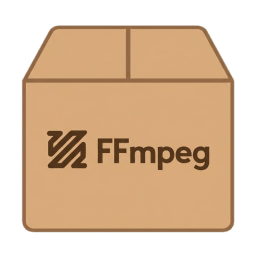

# FFmpegBin

[](https://github.com/Tyrrrz/.github/blob/prime/docs/project-status.md)
[](https://github.com/Tyrrrz/FFmpegBin/actions)
[](https://github.com/Tyrrrz/FFmpegBin/releases)
[](https://github.com/Tyrrrz/FFmpegBin/releases)
[](https://discord.gg/2SUWKFnHSm)

<table>
    <tr>
        <td width="99999" align="center">Development of this project is entirely funded by the community. <b><a href="https://tyrrrz.me/donate">Consider donating to support!</a></b></td>
    </tr>
</table>

<p align="center">
    
</p>

> **Made in 🇺🇦 Ukraine — [despite Russia's best efforts](https://tyrrrz.me/ukraine)**.
> Using this project or its source code comes with the implicit agreement that you condemn Russia's war of aggression against Ukraine, recognize Russia as a terrorist state, and support Ukraine's territorial integrity.

**FFmpegBin** is an automation workflow that produces static builds of [FFmpeg](https://ffmpeg.org) for an array of different platforms.
You can find ready to download assets for each target in the [releases](https://github.com/Tyrrrz/FFmpegBin/releases) of this repository.

Currently supported targets:

|                            | Windows | Linux | macOS | Android            |
| -------------------------- | ------- | ----- | ----- | ------------------ |
| `arm64` / `aarch64`        | ✅      | ✅    | ✅    | ✅ (`arm64-v8a`)   |
| `arm`                      | ❌      | ❌    | ❌    | ✅ (`armeabi-v7a`) |
| `x64` / `x86_64` / `amd64` | ✅      | ✅    | ✅    | ✅                 |
| `x86` / `i386`             | ✅      | ✅    | ❌    | ✅                 |

Builds are performed using [vcpkg](https://github.com/microsoft/vcpkg).
For a list of enabled FFmpeg features, see the [manifest file](vcpkg.json).

## Download

- **[Latest version](https://github.com/Tyrrrz/FFmpegBin/releases/latest)**
- [All versions](https://github.com/Tyrrrz/FFmpegBin/releases)

To programmatically fetch a specific release, use the following URL pattern:

```
https://github.com/Tyrrrz/FFmpegBin/releases/download/${VERSION}/ffmpeg-${OS}-${ARCH}.zip
```
